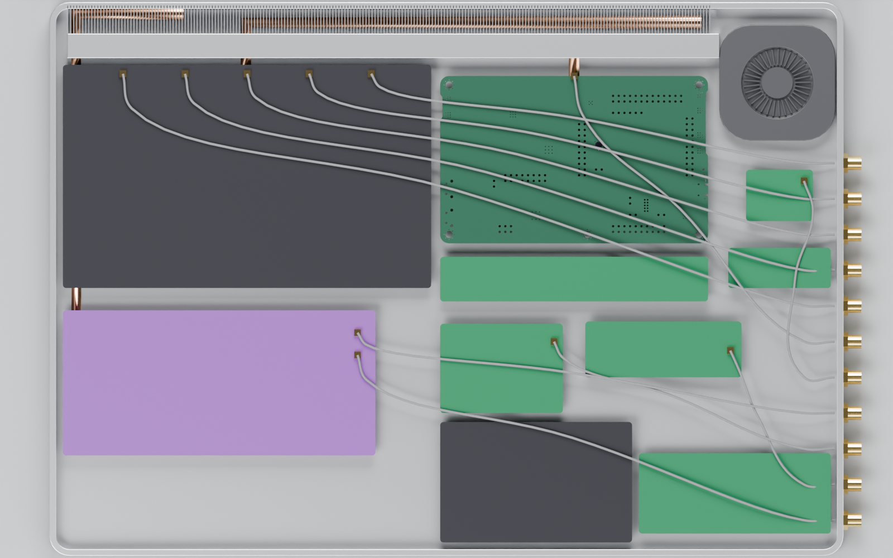

# Survival MacBook Pro: caseless OSINT sled

A ~11 mm machined-aluminium sled that sits under a 16" MacBook Pro and holds a full RF/SIGINT kit as **bare boards, chips facing down onto heat pipes**: KrakenSDR, HackRF, Airspy HF+, Flipper One, Flipper Zero, Proxmark3, Wi-Fi, BLE and LoRa. All 11 antenna ports come out on one edge as SMA bulkheads.


> **Status: concept model.** Nothing here has been built or tested. Board geometry is real where open-hardware files exist; everything else is modelled from published dimensions or is a sized placeholder (see [Geometry sources](#geometry-sources)).

---

## Renders

### Exploded: base plate and thermal layer, boards with RF pigtails, top plate


### Top view with the top plate removed
Rear edge (hinge side) is at the top, and the SMA bulkheads are on the right.


| Position | Board |
|---|---|
| Rear-left, black | KrakenSDR, 5-channel coherent receiver |
| Rear-centre, green | HackRF (real KiCad PCB) |
| Rear-right | Laptop-style blower |
| Along the rear edge | Plenum and fin stack (exhaust) |
| Middle-left, purple | Flipper One bay (Linux host, M.2 LTE + GNSS modem) |
| Middle | USB hub (soldered flex), Airspy HF+ Discovery, Wi-Fi adapter |
| Right column | BLE sniffer (nRF52840), LoRa node |
| Front | Proxmark3 RDV4 (black, over the RF window), Flipper Zero bare-board bay |

### Thermal layer: heat pipes, pedestals, blower and fin stack


### Real downloaded assets
On the left is the HackRF PCB built from Great Scott Gadgets' KiCad design, with 311 components given standard KiCad 3D models. On the right is the official Flipper Zero body model.


---

## Stack-up

| Layer | Thickness | Notes |
|---|---|---|
| MacBook Pro 16" | 16.8 mm | Apple's published 355.7 × 248.1 × 16.8 mm |
| Mac feet + rubber rails | 0.6 + 2.0 mm | Leaves an air gap for the Mac's own intake |
| Top plate | 1.0 mm | Anodised aluminium, grounded, sealed (no openings) |
| Component zone | ~6 mm | Boards chips-down; PCB back at 8.4 mm; U.FL + 1.13 mm micro-coax above |
| Base plate | 2.5 mm | 6061 with grooves for flattened heat pipes; window for the Proxmark |
| Sled feet | 2.0 mm | Gap for the blower's bottom intake |
| **Sled** | **10.8 mm** (+2 mm feet) | |
| **Total with the Mac** | **≈ 32 mm** | |

## How it fits together

- **Chips-down boards.** Every board mounts upside down. Shield cans and hot ICs drop into milled pockets and press onto aluminium pedestals through 0.5 mm thermal pads. `build_sled.py` sizes each pedestal from the actual chip depth it measures in the model.
- **No tall connectors.** SMA and USB-C sockets are removed. RF runs over U.FL pigtails to 11 SMA bulkheads on the right edge. USB runs through a soldered flex hub, with one cable to the Mac.
- **Heat path.** Three flattened 6 × 1.7 mm heat pipes run in the base-plate grooves: KrakenSDR, HackRF and Flipper One. They carry heat to a fin stack along the rear edge. A 52 × 52 × 6.5 mm blower pulls air in through a grille in the base plate and pushes it through a plenum and out of the fins at the back.
- **Everything runs headless.** The Flipper Zero, Flipper One and Proxmark run from the Mac: no screens, no batteries. The Proxmark reads cards through a polycarbonate window in the base plate.

## Geometry sources

| Part | Source of geometry | Fidelity |
|---|---|---|
| HackRF | [greatscottgadgets/hackrf](https://github.com/greatscottgadgets/hackrf) `hardware/hackrf-one` KiCad PCB → STEP → glTF | **Real board.** HackRF Pro board files aren't in the repo, so the HackRF One PCB stands in (same 120 × 75 mm outline). The GSG footprints carry no 3D models, so `patch_hackrf_models.py` maps them to standard KiCad models. Edge SMA jacks and micro-USB are removed. |
| Flipper Zero | [flipperdevices/flipperzero-3d-models](https://github.com/flipperdevices/flipperzero-3d-models) body STEP | **Real body**, shown for reference only. Flipper doesn't publish the internals; the sled has a sized bare-board bay. |
| KrakenSDR | Official enclosure drawing (167.2 × 104.5 mm body, 5 channels on ~27.8 mm pitch) | Bare board and shield cans approximated from those dimensions. |
| Flipper One | Announced specs (155 × 67 × 40 mm cased, still preliminary) | Placeholder bay, 140 × 65 mm. |
| Airspy HF+ Discovery | Published case size 60 × 45 × 10 mm | Approximated bare board. |
| Proxmark3 RDV4, Wi-Fi, nRF52840 BLE, LoRa, USB hub | Typical module sizes | Placeholders. |
| MacBook Pro 16" | Apple's published dimensions | Simplified body, keyboard and lid. |

## Repository layout

```
model/osint_sled.blend        Blender 5.3 scene (collections: chassis, thermal, boards, pigtails, top plate, Mac, reference)
model/assets/hackrf-one.glb   HackRF PCB with components (from the KiCad design)
model/assets/flipper-zero.glb Flipper Zero body (official model)
renders/                      Cycles renders used above
scripts/build_sled.py         Builds the whole scene from code
scripts/render_views.py       Renders a view: hero | exploded | layout | thermal | reference
scripts/fetch_assets.sh       Re-downloads the sources and regenerates model/assets/
scripts/patch_hackrf_models.py Adds standard KiCad 3D models to the HackRF footprints
```

## Rebuild

```bash
python3.13 -m venv .venv && .venv/bin/pip install bpy==5.3.0 cascadio
# optional: regenerate the glTF assets (needs KiCad 7 + kicad-packages3d)
./scripts/fetch_assets.sh
.venv/bin/python scripts/build_sled.py              # writes model/osint_sled.blend
.venv/bin/python scripts/render_views.py hero final  # or exploded/layout/thermal/reference; draft for quick previews
```

To edit it by hand, open `model/osint_sled.blend` in Blender 5.3 or later.

## Engineering caveats

- **The KrakenSDR's case does real work.** Its aluminium case is both a heatsink and a shield, and tuner temperature swings cause phase drift that ruins direction finding. The sled gives it its own heat pipe and a PWM-controlled blower to hold its temperature steady.
- **No board shield means you need pockets.** Each de-cased radio needs its own lidded pocket. De-casing also voids warranties.
- **Power.** With no batteries, the dock needs roughly 25 W through one USB-C PD input.
- **Transmit.** Keep the HackRF's hardware TX-disable on while the receivers are listening. Transmitting without a licence, and acting on intercepted communications, is illegal in most jurisdictions.
- **Flipper One** isn't in mass production yet, and its published dimensions may change.

## Credits and licences

This repo bundles third-party geometry, which stays under its own licence:

- **HackRF One hardware** © Great Scott Gadgets, [CERN-OHL-P-2.0](https://github.com/greatscottgadgets/hackrf/blob/master/hardware/hackrf-one/LICENSE). It is in `model/assets/hackrf-one.glb` and the `.blend`.
- **Flipper Zero 3D models** © Flipper Devices, [GPL-3.0](https://github.com/flipperdevices/flipperzero-3d-models/blob/master/LICENSE). It is in `model/assets/flipper-zero.glb` and the `.blend`.
- **KiCad 3D component models**, [CC-BY-SA 4.0 with the KiCad libraries exception](https://www.kicad.org/libraries/license/). These are embedded in the HackRF asset.
- KrakenSDR dimensions come from KrakenRF's published drawing. The drawing itself is not included.
